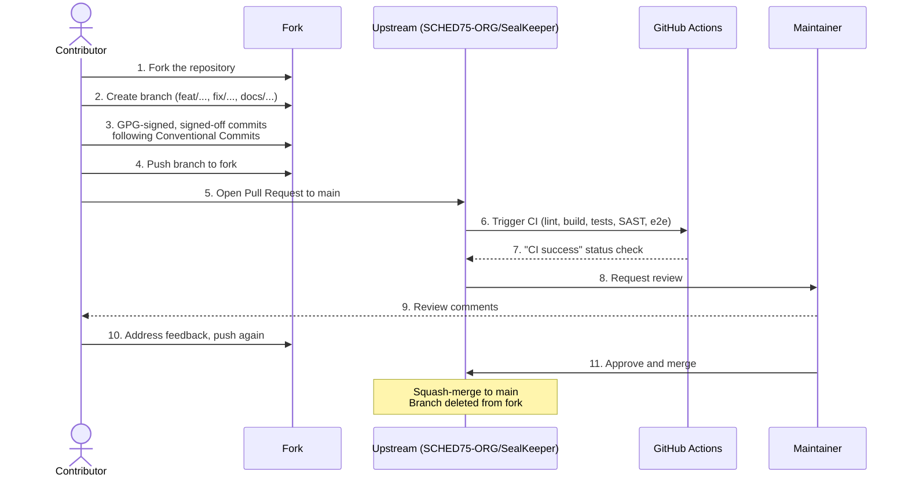
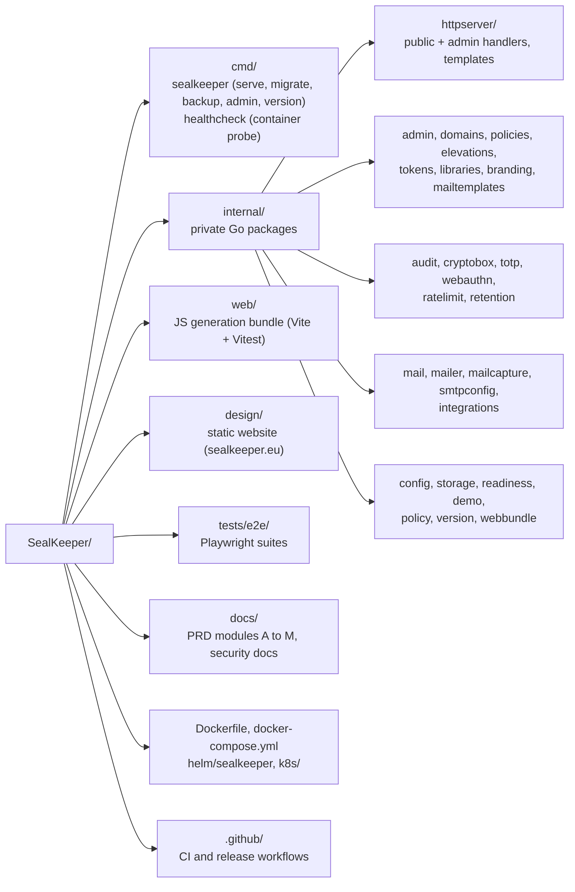

# Contributing to SealKeeper

Thank you for considering a contribution to SealKeeper. The project welcomes contributions of all kinds — bug reports, feature requests, documentation improvements, code patches, security audits, translations.

Please take a moment to read this guide before opening an issue or pull request. Following these conventions makes review faster and increases the chance your contribution is merged smoothly.

## Code of Conduct

By participating, you agree to abide by our [Code of Conduct](https://github.com/SCHED75-ORG/SealKeeper/blob/main/CODE_OF_CONDUCT.md). In short: be respectful, be patient, assume good faith, and remember that everyone is volunteering their time.

## Filing Issues

Before opening a new issue, please:

1. Search [existing issues](https://github.com/SCHED75-ORG/SealKeeper/issues) to avoid duplicates
2. For bugs: give the SealKeeper version (`sealkeeper version`), the run mode (`SK_MODE`, `SK_DEMO_MODE`), the database (SQLite or Postgres) and the steps to reproduce
3. For features: explain the user need, and the PRD requirement (`FR-*` identifier under [`docs/prd/`](https://github.com/SCHED75-ORG/SealKeeper/tree/main/docs/prd)) it relates to, if any
4. For questions: start a [discussion](https://github.com/SCHED75-ORG/SealKeeper/discussions) rather than an issue
5. For security: **do not file a public issue** — see [`SECURITY.md`](https://github.com/SCHED75-ORG/SealKeeper/blob/main/SECURITY.md)

## Submitting Pull Requests

### Before you start

- For non-trivial changes, please open an issue first to discuss the approach. This avoids wasted work if the change is not aligned with project direction.
- For typo fixes and documentation improvements, you can submit a PR directly.
- Requirements live in the PRD modules under [`docs/prd/`](https://github.com/SCHED75-ORG/SealKeeper/tree/main/docs/prd) (A to M, in French); implementation conventions live in [`CLAUDE.md`](https://github.com/SCHED75-ORG/SealKeeper/blob/main/CLAUDE.md). Read both before changing behaviour.

### Pull request workflow

Changes reach `main` only through a pull request: nobody pushes to `main` directly. A PR is merged (squash-merge) once CI is green and a maintainer has approved it.



### Pull request checklist

- [ ] Branch from `main`, with a descriptive name like `feat/policy-validation` or `fix/smtp-timeout`
- [ ] Every commit is **GPG-signed** (`git commit -S`, or `commit.gpgsign = true`) and signed-off (`git commit -s`) — see the DCO section below
- [ ] Every commit message follows the [Conventional Commits](https://www.conventionalcommits.org/) format and cites the `FR-*` identifiers it implements
- [ ] New code is covered by tests (Go and/or Vitest) where applicable
- [ ] Any change touching SQL ships both migration dialects and passes `go test` on SQLite **and** on Postgres (`TEST_PG_DSN`, see below)
- [ ] `make lint` and `make test` pass locally (plus `make test-js` if `web/` changed)
- [ ] If the change affects user-facing behaviour, documentation is updated
- [ ] If the change affects security properties, a note is added in the PR description
- [ ] The PR description explains the motivation and links the related issue
- [ ] The CI `CI success` check is green

### Developer Certificate of Origin (DCO)

SealKeeper is licensed under the AGPL-3.0-or-later, which requires us to track the provenance of contributions. We use the [Developer Certificate of Origin](https://developercertificate.org/) for this. Each commit must include a sign-off line:

```
Signed-off-by: Your Name <your.email@example.com>
```

You can add this automatically with `git commit -s` or `git commit --sign-off`. By signing off, you certify that you have the right to submit the contribution under the project license.

The sign-off does not replace the cryptographic signature: commits must also be GPG-signed with a key registered on your GitHub account, so that they show as **Verified**. Never bypass signing (`--no-gpg-sign`) or the pre-commit hooks (`--no-verify`).

### Commit message convention

We follow [Conventional Commits](https://www.conventionalcommits.org/):

```
<type>(<scope>): <short description>

<optional longer description, citing the FR-* requirements involved>

<optional footer (e.g. BREAKING CHANGE, Refs #123)>

Signed-off-by: Your Name <your.email@example.com>
```

Allowed types (enforced by the `commit-msg` pre-commit hook): `feat`, `fix`, `docs`, `chore`, `ci`, `refactor`, `perf`, `test`, `build`, `style`, `revert`. The scope is usually the package or area touched (`admin`, `audit`, `policies`, `web`, `site`, `helm`, …).

Examples:

```
fix(api): constant-latency public request path (FR-B.13)

fix(audit): HMAC-keyed chain with sealed head anchor (FR-E.1/FR-E.3)

docs(site): fix the roadmap link
```

## Development Setup

### Prerequisites

- Go **1.26.10** (pinned in `go.mod`'s `toolchain` directive, CI and the Dockerfile)
- Node.js 20+ and npm (generation bundle in `web/`, Playwright suites in `tests/e2e/`)
- `make` and `git`
- Optional: Docker (image build, Compose stack) and a PostgreSQL server for the parity test run
- Optional: [`pre-commit`](https://pre-commit.com/) (`pip install pre-commit && pre-commit install`) to run the hooks of `.pre-commit-config.yaml` before each commit

No external service is needed for development: SealKeeper defaults to SQLite, and `SK_MODE=eval` generates a master secret, captures outgoing mail in memory and prints the bootstrap admin password once on stdout.

### Building and running

```bash
# Clone the repository
git clone https://github.com/SCHED75-ORG/SealKeeper.git
cd SealKeeper

# List every Makefile target
make help

# Build the binary into ./dist/sealkeeper
make build

# Build the JS generation bundle and embed it (standalone binaries)
make web-embed

# Run locally in eval mode (SQLite, captured mail, http://localhost:8443)
SK_MODE=eval ./dist/sealkeeper serve

# Or start the Compose stack (Postgres + SealKeeper + Caddy)
make compose-up
```

### Testing

```bash
# Go unit tests, race detector + coverage (SQLite)
make test

# Same suite replayed against Postgres: the role must be allowed to CREATE DATABASE
TEST_PG_DSN="postgres://postgres:pw@127.0.0.1:5432/postgres?sslmode=disable" \
  go test -count=1 -p 4 ./internal/... ./cmd/...

# JS generation bundle (Vite + Vitest, 90 % coverage threshold)
cd web && npm ci && npm test      # or: make test-js
npm run build                     # rebuilds web/dist/sealkeeper-generation.umd.js

# Playwright end-to-end (launches the binary itself)
make e2e                          # @happy-path subset on Chromium, as in CI
cd tests/e2e && npx playwright test

# Static website under design/
cd tests/e2e && npx playwright test -c playwright.site.config.ts
```

Repository tests take their database from `storagetest.DSN(t)` (`internal/storage/storagetest`), never from a hard-coded `sqlite://` path, so the same suite runs on both engines. Run both before submitting anything that touches SQL.

### Linting

```bash
make lint   # golangci-lint, prettier, eslint, yamllint, markdownlint, hadolint
make fmt    # gofmt + goimports + prettier
```

CI uses **golangci-lint v2.12.2** with `.golangci.yml`, plus gosec, semgrep and govulncheck (blocking on affecting CVEs). After a dependency bump, run `govulncheck ./...` locally. Surgical lint exemptions take the form `// #nosec Gnnn -- rationale`.

### Project layout



`cmd/sealkeeper/main.go` wires every repository into `httpserver.Server`; [`CLAUDE.md`](https://github.com/SCHED75-ORG/SealKeeper/blob/main/CLAUDE.md) describes each package, the data model, the HTTP surface and recipes for common tasks (new admin page, new column, new CLI subcommand).

### Coding standards

- Run `gofmt` (or `make fmt`) on all Go code before committing
- Fix everything `golangci-lint` reports; do not add a blanket `//nolint`
- Every migration ships in **both** dialects (`internal/storage/migrations/{postgres,sqlite}/`), forward-only; never edit a migration that has landed on `main`
- Every new encrypted field gets its own cryptobox AAD tag; state-changing admin handlers append an audit event
- Never use `Math.random` in `web/`: randomness comes from `crypto.getRandomValues()` only
- The website CSP has `script-src 'self'`: no inline `<script>` or CDN script in `design/` — behaviour goes in `design/site.js`
- Write tests for new functionality; Vitest enforces a 90 % coverage threshold on `web/`
- Prefer explicit over clever — security code should be boring

## Licence

SealKeeper is licensed under the [GNU Affero General Public License v3.0 or later](https://github.com/SCHED75-ORG/SealKeeper/blob/main/LICENSE) (AGPL-3.0-or-later). By contributing, you agree that your contribution is released under the same licence.

## Reporting Security Issues

Please **never** report security vulnerabilities in a public issue, pull request or discussion. See [`SECURITY.md`](https://github.com/SCHED75-ORG/SealKeeper/blob/main/SECURITY.md) for the private channels and the coordinated disclosure process.

## Recognition

Contributors are credited in the release notes ([`CHANGELOG.md`](https://github.com/SCHED75-ORG/SealKeeper/blob/main/CHANGELOG.md)) for the versions they contributed to. Security researchers are also listed in the [hall of thanks](https://sealkeeper.eu/hall-of-thanks.html).

## Questions?

If anything in this guide is unclear, please start a [discussion](https://github.com/SCHED75-ORG/SealKeeper/discussions).

Thank you for contributing to SealKeeper!
