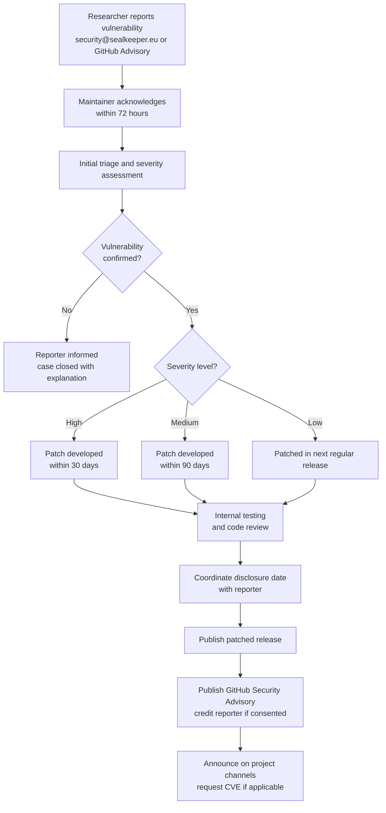

# Security Policy

SealKeeper handles cryptographic operations and credential transmission. We take security reports seriously and commit to acknowledging, investigating, and remediating valid issues in a timely manner.

## Supported Versions

| Version | Supported |
|---|---|
| 0.1.1 | ✅ Supported |
| ≤ 0.1.0 | ❌ Please upgrade |

Until we reach v1.0.0, only the latest tagged release receives security updates.

## Reporting a Vulnerability

**Please do not file public GitHub issues for security vulnerabilities.** Public disclosure before a patch is available puts users at risk.

Instead, report security issues by one of these channels, in order of preference:

1. **Email** — `security@sealkeeper.eu` (PGP encryption recommended; key fingerprint below)
2. **GitHub Security Advisories** — [private advisory form](https://github.com/SCHED75-ORG/SealKeeper/security/advisories/new)

### PGP Key

```
Fingerprint: 1E11 670E 11A0 4C0D 808F  B94D CCC4 93CB A701 6D6E
Algorithm:   ed25519 (signing/cert/auth) + cv25519 (encryption)
Created:     2026-05-16
Expires:     2028-05-15
User ID:     SealKeeper Security Contact <security@sealkeeper.eu>
Full key:    https://sealkeeper.eu/.well-known/pgp-key.asc
Keyserver:   https://keys.openpgp.org/search?q=security@sealkeeper.eu
```

### Release signing key

Release tags and the `SHA256SUMS` file attached to every release are signed
with the maintainer's key, not with the security-contact key above:

```
Fingerprint: BB1F EC0B 3D83 B6F0 3CCF  2869 FA3F BAF2 05E4 48DA
Algorithm:   ed25519 (signing/cert) + cv25519 (encryption)
Created:     2026-07-26
Expires:     2028-07-25
User ID:     Pascal-Louis DARMON
Full key:    docs/security/release-signing-key.asc (this repository)
```

[`docs/security/verification.md`](docs/security/verification.md) explains how to check a release with it.

## What to Include

A useful security report typically contains:

- A clear description of the vulnerability and its potential impact
- Steps to reproduce, ideally with a minimal proof of concept
- The affected version(s) of SealKeeper
- Your suggested remediation, if any
- Whether you wish to be credited publicly when the fix is published

We will respond within **72 hours** with an acknowledgement and an initial assessment. We aim to publish a patched release within **30 days** for high-severity issues and **90 days** for medium-severity issues.

## Hall of thanks

Researchers who report a valid vulnerability are credited in the published advisory and listed in the [hall of thanks](https://sealkeeper.eu/hall-of-thanks.html) on the project website, and receive a signed, numbered certificate of thanks — unless they ask to remain anonymous.

| Researcher | Advisories |
|------------|------------|
| Sri Charan Pedhiti ([@Char0n1507](https://github.com/Char0n1507)) | [GHSA-xr59-fxvh-vx8h](https://github.com/SCHED75-ORG/SealKeeper/security/advisories/GHSA-xr59-fxvh-vx8h), [GHSA-h3vw-xg58-625j](https://github.com/SCHED75-ORG/SealKeeper/security/advisories/GHSA-h3vw-xg58-625j) |

## Scope

The following are considered in scope:

- The Go service in `cmd/sealkeeper` and packages under `internal/`
- The client-side generation JavaScript (`web/`)
- The default Docker image and Docker Compose configuration
- The static website under `design/`

The following are out of scope:

- Issues in third-party dependencies (please report them upstream)
- Configuration mistakes by operators that are documented as risky
- Social engineering of project maintainers
- Physical attacks on infrastructure
- Denial-of-service attacks from unauthenticated traffic

## Coordinated Disclosure



We follow a 90-day coordinated disclosure timeline by default. We may shorten this period for issues with active exploitation, or extend it (with the reporter's agreement) for issues requiring complex coordinated fixes.

After remediation, we publish a security advisory on the GitHub repository, credit the reporter (unless anonymity was requested), and announce the fix on the project's communication channels.

## Bug Bounty

SealKeeper is a community-funded open source project and does not currently offer monetary bug bounties. We deeply appreciate security research and recognise valid reports publicly with the reporter's permission. We are exploring partnerships with security research foundations to fund a modest bounty programme in the future.

## Past Advisories

76 advisories have been published. One affects 0.1.0 and is fixed in [v0.1.1](https://github.com/SCHED75-ORG/SealKeeper/releases/tag/v0.1.1): production accepted a hand-made or degenerate `SK_MASTER_SECRET` (medium, [GHSA-f24m-cpmv-84h2](https://github.com/SCHED75-ORG/SealKeeper/security/advisories/GHSA-f24m-cpmv-84h2)). The other 75 affect versions before 0.1.0 and are fixed in [v0.1.0](https://github.com/SCHED75-ORG/SealKeeper/releases/tag/v0.1.0):

| Severity | Advisories |
|---|---|
| Critical | 1 |
| High | 8 |
| Medium | 28 |
| Low | 38 |

The full list, with CVE identifiers where assigned, is on the [repository's security advisories page](https://github.com/SCHED75-ORG/SealKeeper/security/advisories).

---

Thank you for helping keep SealKeeper and its users safe.

The Maintainer
